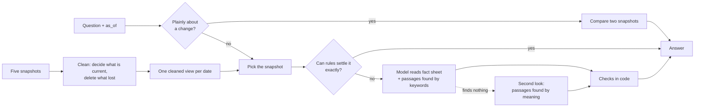

# Answering member questions from five snapshots of a credit union's website

My submission for the interface.ai knowledge-system take-home. `build()` in `solution.py` returns
an object with `ingest(snapshot)`, `answer(question, as_of=None)` and `conflicts()`, which the
organisers' harness drives. Setup and the API key are in [NOTES.md](NOTES.md).

**The task.** Given five dated copies of a credit union's website, answer members' questions with
the value that was current on the date asked (never an out-of-date one), say so when the site does
not answer, and list where the site contradicts itself. The organisers' harness scores accuracy
(55%), the contradictions list (15%), consistency when a question is asked again or reworded (15%)
and speed (15%).

**The idea in one paragraph.** The website contradicts itself. A rate changes and an old calculator
page keeps showing the old number; a year-old news story still quotes last year's branch count.
Hand a language model both numbers and it will sometimes repeat the wrong one. So this system
settles what is current **when the snapshots are loaded**, with explicit rules, and deletes
everything that lost. Only then does anything answer questions: rules for what they can settle
exactly (rates, hours, addresses, links), and a small language model for the rest. The model reads
only the cleaned site, and its answer is checked in code before it is returned.

## Results

| Test | Result |
|---|---|
| Organisers' 40 practice questions, their scorer, live | 39 of 39 fully right (accuracy 0.97 over all 40); consistency 1.00; no out-of-date value in any answer |
| Same, with no API key (rules only) | accuracy 0.69 |
| Independent question bank, half I developed against | 223 of 229 fully right |
| Independent question bank, held-back half | 230 of 232 (227 at first look) |
| Fresh rewordings of the practice questions | 110 of 110 |
| "How has it changed?" questions | 36 of 36 |
| Speed: slowest 5% of answers, live | 1.2 to 1.4 s over the last three runs, down from 1.7 to 2.2 s (full marks at 2 s or less) |
| Contradictions list | 47 entries; all 7 contradictions the practice questions point at are listed, with the right winner |

*Fully right*: every value the question requires is in the answer, and no out-of-date value is. One
practice question (and the bank's rewordings of it) has no required values, so the scorer cannot
mark it; the counts leave it out. *Live*: with real model calls, not replayed ones.

Why I trust the bank numbers more than the practice score, and the one way the held-back half stopped
being blind, are under [How I tested it](#how-i-tested-it).

## How it works



### 1. Clean first

For two copies of the same rate, the first rule that separates them wins:

1. the newer "effective as of" date printed under the rate table;
2. the more official kind of page: rates page, then product page, document, news, blog, and last
   calculators, listings and promotions (an expired promotion never counts);
3. the more recent download.

Two rows count as "the same rate" only if product, variant (business, Roth, introductory...),
term, balance or loan-amount tier and model-year band all match, so different tiers are never
mistaken for a contradiction. A few details the tests forced: a table on a campaign page is often
headed by a slogan, so it is named after the official product of its section; model-year bands roll
forward each year ("2018-20" becomes "2018-21"), so a band is known by its place in the table, not
its years.

Sentences repeated across dated articles (a staff count, a branch count) are grouped with their
numbers masked, and the most recently published copy wins. A running count ("the fourth time", a
year later "the fifth time") resolves to the later article. Whatever loses is removed before
anything is indexed: the stale table, its fine print and the sentences that quote its numbers.

### 2. Route the question

- **Which snapshot.** No date: the newest. An `as_of` date (or "as of May 2026" in a question that
  looks back): the last snapshot on or before it.
- **Rules first.** A rate look-up whose matched table accounts for every word of the question, a
  yes/no about a stated percentage, "which page shows the ... rates", branch hours and addresses.
  No model call, a few milliseconds, the same words every time.
- **Everything else goes to the model** (Anthropic's Haiku 5.5) in one call, or two if the first
  reply is unusable (see the checks below). It reads a fact sheet (every current rate, the latest
  organisation figures, contact details) plus passages found by keyword search, and replies as a
  small JSON object: answerable or not, the answer, and the items it relied on.
- **A second look** runs alongside: the same question with passages found by meaning (a small
  embedding model that runs locally). It is used only when the first look finds nothing, which
  usually means the member's words differ from the site's ("change my phone number" against
  "update your personal information").

### 3. Checks in code

- Every number in a model answer must appear in what the model was shown, or the answer is dropped.
- Where the rules found the exact rate row, the model's answer must state that row's value.
- An answer that breaks off, or answers a different question, is asked for once more.
- "The website doesn't list X, but here are other things" becomes a plain "not listed", which is
  what the scorer expects for a question the site cannot answer.
- Asking the same question twice returns the stored answer, so repeats are identical.

### 4. Questions about a change

"How has the 60-month auto loan APR changed since May 12, 2026?" needs two snapshots, and its answer
names an old value on purpose, which every other answer must never do. So this path opens only for
three unmistakable wordings: a "has/did ... change" question about a published figure, two dated
values side by side, or one dated past value plus "now". Rate rows are then followed back through
the snapshots by rules. Anything else goes to the model with the earlier copy of the same pages
beside today's. Looser wordings ("since May", "the previous rate") get today's value. If such a
question really was about a change, today's value still earns part of the credit; a comparison
triggered by mistake would name an out-of-date value and score nothing.

### 5. The contradictions list

`conflicts()` reports four kinds, each with every competing value, the winner and the reason: a
stale copy still live next to the current one; an official rate that changed between snapshots; a
repeated statement whose number changed across articles; and a sentence that kept its wording while
a figure in it changed.

## Speed

Full speed marks need the slowest 5% of answers to take 2 seconds or less. Rules answers take a
few milliseconds, so the question is how long a model call takes. I timed the request on the same
60 questions, two attempts each, with the settings interleaved so that changes in the API's speed
landed on every setting alike:

| Model call | Typical | Slowest 5% | Slowest |
|---|---|---|---|
| Before: reply shape enforced by a JSON schema, thinking left on | 1.12 s | 1.66 s | 2.47 s |
| After: shape asked for in words, thinking off | 0.91 s | 1.24 s | 1.54 s |

Almost all of a call is fixed overhead before the first word. The enforced schema added to that and
slowed the writing too; the slowest answers were the ones where the model stopped to think first.
Every reply under the new setting came back as clean JSON (120 of 120), and a lenient reader
handles the odd one wrapped in a code fence.

Two kinds of question got worse without thinking: "last year" questions were declined instead of
answered with the years the site does report, and a refusal worded in the model's own words ("the
branch does not have published lobby hours") no longer counted as one. Only the held-back half and
the rewordings showed it (four and two answers). A firmer instruction and a wider "not listed"
check fixed both, and every test set then scored the same as before or better.

Two smaller changes: the second look now starts at the same moment as the first, so it never adds a
wait of its own; and all model calls for one answer share a 15-second budget, with
no automatic retries and a one-minute pause after three failures in a row. A slow, failing or
rate-limited API then costs a little accuracy (those questions get the rules answer) instead of
every answer's speed, and no answer can come near the scorer's 60-second limit.

## How I tested it

Forty practice questions that I had tuned against prove very little, so most of the testing went
into questions the system had never seen, marked by machine so that no result depends on anyone's
judgement.

- **An independent question bank: 465 questions.** It was written from the website alone, one area
  at a time, without access to this code. Every item carries a word-for-word quote from a snapshot
  as evidence (a script checked every quote against the files) and is marked the way the
  organisers' scorer marks: values that must appear, and out-of-date values that must not. Each
  key was then checked by answering its question independently, without seeing the key, and every
  disagreement was audited; 22 of 487 items were dropped as arguable. The rest was split in two by
  a fixed rule. I fixed things against one half only and used the other half to confirm: 227 of 232
  at first look, 230 after the general fixes made against the first half. One exception, in the
  open: the speed change described above cost four held-back answers, all of two kinds, and the fix
  for it was made with those questions in view. Held-back results after that are no longer blind
  for those two kinds of question.
- **Fresh rewordings, with the code frozen.** 120 new ways of asking the practice questions
  (indirect, spoken, plain), of which 113 were accepted as meaning the same and 110 can be marked:
  109 of 110 right at first look, 110 of 110 after one fix (a spoken "um, so..." hid the kind of
  question from the rules). The same caveat as the held-back half applies to two of them since the
  speed change.
- **Questions about a change.** The bank only ever asked what a value was on a date, while the
  assignment also mentions questions about things that changed, so 36 such questions were written
  to the same rules. Before the change path existed: 8 right, 21 half right, 7 wrong. Now 36 of 36.
- **Look-alike traps.** A change answer names an old value on purpose, so it must never fire by
  mistake. About 5,000 questions that look like change questions but are not ("Do you have a lower
  rate...?") were run against it: none triggers it.
- **A hostile review before hand-in.** Fuzzed inputs (empty, 10,000 characters, odd dates and
  scripts), a fake API that fails in every way it can, a fresh install on Python 3.11, and a check of
  everything that would become public. It found real problems, all fixed: a pattern that took over a
  minute on very long questions, no overall time limit per answer, loan-amount questions that listed
  every tier containing the amount, and a year in the question ("in 2026") hiding a listed rate.
- **Unit tests** (87 of them) on small made-up pages, so they run in a second with no snapshots and
  no key (the packages in `requirements.txt` installed).

What the bank caught that the practice set had hidden, each fixed in a general way rather than by
special-casing a question: rate look-ups failing on older snapshots because the credit union's own
name was read as a product word; "non-jumbo" read as "jumbo"; a stale campaign table leaking into
an answer; a page cleaner that cut off every FAQ after a teaser block; long PDF text cut before the
answer; a misspelt product name hiding it from the rate tables; and a question about IRA rates
answered with a youth savings account that merely sits on the retirement page.

The bank itself is not in this repository: it quotes the website, which is not mine to
redistribute.

## Tried and dropped

Each was measured, not guessed:

- **Merging keyword and meaning rankings into one list.** It pushed out passages that keywords had
  rightly put first.
- **Adding meaning matches to every prompt.** No more right answers, and once an out-of-date figure
  came back in with an extra passage.
- **A higher model effort setting.** No more accurate.
- **Fewer passages per prompt.** Barely faster (inside the noise), and every passage removed is a
  chance to miss an answer.
- **Sending a second, identical request when the first is slow.** A second attempt was as slow as
  the first, so it bought nothing.
- **Showing the jumbo figure next to the standard one for past dates.** The old jumbo figure often
  equals the newer standard one, so it reads as the stale value.

## Known limits

- A few facts that live only in PDFs or a single old article are still missed (a member count in a
  newsletter, a media contact, one long list): about 2% of the question bank.
- Model answers vary a little in wording between runs. Rates, hours, addresses and links do not
  change value: the rules either write those answers or check that the model's answer states the
  value they found.
- `conflicts()` could only be measured against a list written independently from the same
  snapshots. Nine in ten of its entries match one there, but it finds only about a third of that
  list: it does not look for contradictions in running text about people, dates or one-off amounts.
- Organisation figures (members, assets) come from press releases; a newer figure printed only in a
  report PDF is not picked up.
- A table that loses one row to a newer copy is set aside whole, so a row that appears only in that
  table goes with it (one mortgage relief rate in the latest snapshot).
- Only plainly worded comparisons take the change path, and a change outside the rate tables is
  found only when keyword search brings up the passage in both copies.

## Running it

From this folder:

```bash
pip install -r requirements.txt
python -m unittest discover tests  # no key or snapshots needed
```

From the organisers' kit folder (the one with `harness/`, `eval/` and `snapshots/`):

```bash
export ANTHROPIC_API_KEY=...        # optional: without it the system answers from rules alone
python harness/run_eval.py --submission /path/to/this/folder --eval eval/public_eval.jsonl
```

## Repository map

| Path | What it does |
|---|---|
| `solution.py` | Entry point: `build()` |
| `kb/text.py`, `pages.py`, `tables.py` | Clean pages, classify them, read rate tables |
| `kb/facts.py`, `statements.py`, `hours.py`, `snapshot.py` | Decide what is current; gather hours, locations and contact details; remove what is out of date |
| `kb/search.py`, `meaning.py` | Keyword search, and search by meaning |
| `kb/lookup.py`, `rules_answer.py` | Answers without a model |
| `kb/sheet.py`, `reader.py` | The fact sheet, the model call and its checks |
| `kb/history.py`, `dates.py` | Questions about a change; dates in a question |
| `kb/conflicts.py`, `system.py` | The contradictions list, and the object the harness talks to |
| `tests/` | Unit tests on small made-up pages |
| `tools/dev_report.py` | Prints each practice answer with its score and which path wrote it |
